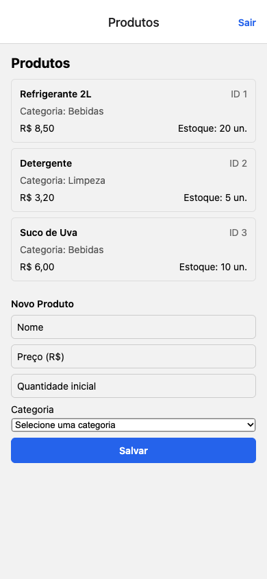
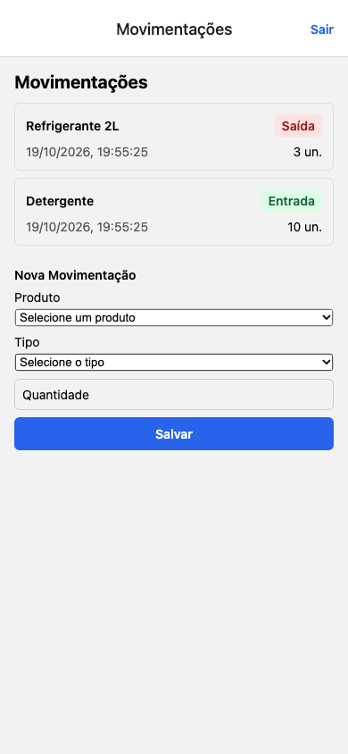

# Controle de Estoque — Atividades 01 e 02

Aplicativo Expo para listar e cadastrar produtos e registrar entradas e saídas de estoque. As telas ficam no menu lateral após o login.

## Executar

```bash
npm ci
npm start
```

Para abrir no navegador, pressione `w` no terminal do Expo ou execute `npm run web`.

**Acesso de demonstração:** `professor@ifpr.edu.br` / `123456`.

## Telas implementadas

### Produtos



### Movimentações



Os dados são mantidos pela API simulada em memória durante a execução do aplicativo.
